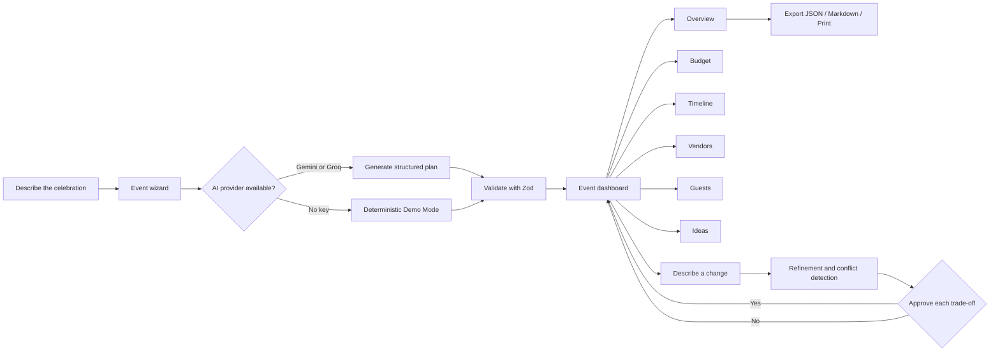
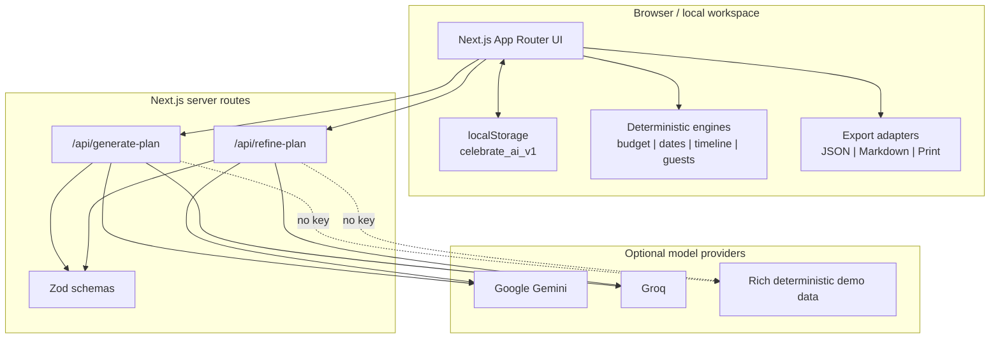
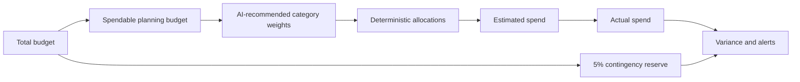
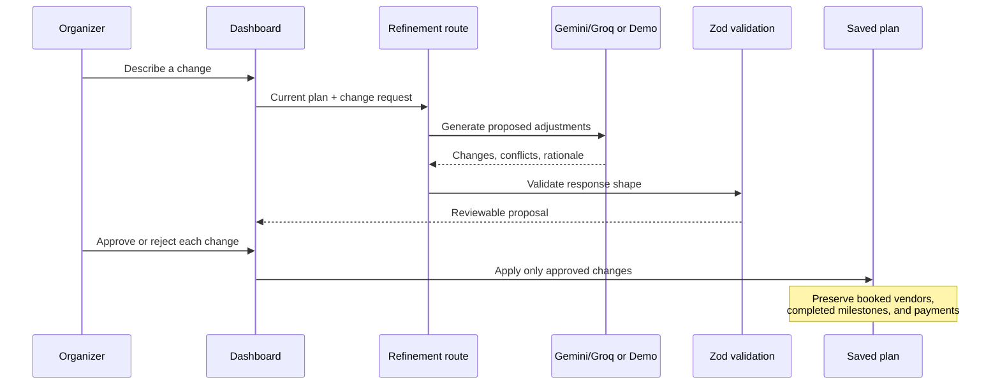

# Celebrate AI

> **Turn a blank canvas into a celebration worth remembering.**

Celebrate AI is a privacy-first, AI-assisted event planning workspace for weddings, milestone birthdays, and community celebrations. Describe the occasion, choose your constraints, and receive a practical plan with a budget, timeline, vendors, guest tracking, ideas, and adaptive replanning.

<p align="center">
  <a href="https://github.com/Ainz7860/celebrate-ai"></a>
  <a href="https://nextjs.org/"></a>
  <a href="https://www.typescriptlang.org/"></a>
  <a href="https://vitest.dev/"></a>
</p>

## Why Celebrate AI?

Planning an event usually means juggling spreadsheets, chat threads, vendor calls, deadlines, dietary needs, and last-minute changes. Celebrate AI brings those moving parts into one calm, visual command center:

- **Generate a complete first plan** from a few event details.
- **Keep money honest** with deterministic TypeScript calculations and a protected 5% contingency.
- **Work backward from the event date** so every milestone has a useful deadline.
- **Protect commitments** when a plan is refined: booked vendors, completed tasks, and payments are not casually overwritten.
- **Stay in control**: AI suggests trade-offs; the organizer approves changes.
- **Start instantly** in Demo Mode, even without an API key.

## Product flow



## Feature map

| Area | What it does |
| --- | --- |
| **Event wizard** | Captures event type, date, location, guest count, style, budget, and priorities. |
| **Overview** | Gives the organizer a single view of readiness, spend, guests, deadlines, and risks. |
| **Budget** | Shows category allocations, estimates, actual spend, variance, and the 5% emergency reserve. |
| **Timeline** | Backward-schedules milestones from the celebration date and highlights overdue work. |
| **Vendors** | Organizes sourcing, quote comparison, interview questions, and inspection criteria. |
| **Guests** | Tracks RSVPs, seats, invitation delivery, and dietary/allergy requirements. |
| **Ideas** | Presents the generated creative direction, activities, menu concepts, and decor ideas. |
| **Adaptive replanning** | Models changes such as weather, budget cuts, guest increases, or date shifts. |
| **Exports** | Produces structured JSON, an executive Markdown summary, or a print-ready plan. |

## Planning architecture



## Trustworthy money model

AI can recommend proportions and explain trade-offs, but it does not perform the final arithmetic. Calculations live in the typed budget engine so totals are predictable and testable.



The dashboard separates **allocated**, **estimated**, and **actual** values. That makes it possible to spot a plan that looks affordable on paper but is already drifting in reality.

## Adaptive replanning

Refinement is intentionally approval-based. A new condition is converted into explicit proposed changes rather than silently mutating the organizer's commitments.



## Tech stack

- **Framework:** Next.js 16 App Router and React 19
- **Language:** TypeScript
- **Styling:** Tailwind CSS 4 and custom UI components
- **Charts:** Recharts
- **Validation:** Zod
- **AI:** Google Gemini via `@google/genai`, with Groq-compatible configuration
- **Persistence:** Browser `localStorage` (no database required)
- **Testing:** Vitest
- **Deployment:** Vercel-ready

## Getting started

### Prerequisites

- Node.js 20 or newer
- npm
- Optional: a Gemini or Groq API key

### Install and run

```bash
npm install
npm run dev
```

Open [http://localhost:3000](http://localhost:3000).

### Configure live AI (optional)

Copy the example environment file:

```bash
copy .env.example .env.local
```

Then add one provider:

```env
# Google Gemini
GEMINI_API_KEY=your_gemini_api_key_here
GEMINI_MODEL=gemini-2.0-flash

# Or Groq
GROQ_API_KEY=your_groq_api_key_here
GROQ_MODEL=openai/gpt-oss-120b
```

No key is required to explore the product. Without one, the app uses its complete deterministic Demo Mode.

## Quality checks

```bash
# Unit tests
npx vitest run

# Lint
npm run lint

# Production build
npm run build
```

The unit tests cover budget calculations, date handling, exports, and timeline scheduling in [`src/lib/__tests__/`](./src/lib/__tests__/).

## Project map

```text
src/
  app/
    page.tsx                 Landing page and saved-event launcher
    events/new/              Event creation wizard
    events/[id]/             Event dashboard
    api/
      generate-plan/         Initial plan generation endpoint
      refine-plan/           Adaptive replanning endpoint
  components/
    dashboard/               Overview, budget, timeline, vendor, guest, idea tabs
    layout/                  Navbar and footer
    ui/                      Reusable visual primitives
    wizard/                  Event setup flow
  hooks/                     Client-side event state hooks
  lib/
    budget.ts                Deterministic budget calculations
    dates.ts                 Date helpers
    guests.ts                RSVP and dietary logic
    timeline.ts              Backward scheduling and overdue detection
    export.ts                JSON, Markdown, and print exports
    gemini.ts                AI provider integration and fallback
    schemas.ts               Runtime validation
    storage.ts               localStorage persistence
    types.ts                 Shared domain types
    __tests__/               Focused unit tests
```

## Privacy and safety

- Event plans are stored locally in the browser by default.
- API keys belong in `.env.local`, which is ignored by Git.
- The client never needs a database account to use Demo Mode.
- AI output is validated before it becomes application state.
- Financial totals are recomputed by deterministic application code.
- Refinement preserves high-value commitments and asks for approval before applying trade-offs.

Do not commit real API keys, private guest data, or `.env.local` files.

## Deployment

### Vercel

1. Import [`Ainz7860/celebrate-ai`](https://github.com/Ainz7860/celebrate-ai) into Vercel.
2. Set `GEMINI_API_KEY` and/or `GROQ_API_KEY` if live generation is desired.
3. Use `npm run build` as the build command.
4. Deploy.

The repository includes [`vercel.json`](./vercel.json) with the Next.js framework and build configuration.

### Local production preview

```bash
npm run build
npm start
```

## GitHub workflow

This project is published at [`github.com/Ainz7860/celebrate-ai`](https://github.com/Ainz7860/celebrate-ai). The display name is **Celebrate AI** and the GitHub repository slug is `celebrate-ai`.

```bash
git clone https://github.com/Ainz7860/celebrate-ai.git
cd celebrate-ai
npm install
npm run dev
```

## Contributing

1. Create a focused branch.
2. Keep domain logic deterministic and covered by tests.
3. Never commit secrets or real personal event data.
4. Run `npx vitest run`, `npm run lint`, and `npm run build`.
5. Open a pull request with a concise description of the user-facing impact.

## License

No license has been declared yet. Add a `LICENSE` file before distributing this project outside the repository.

---

Made for calmer planning, better decisions, and celebrations that feel effortless.
